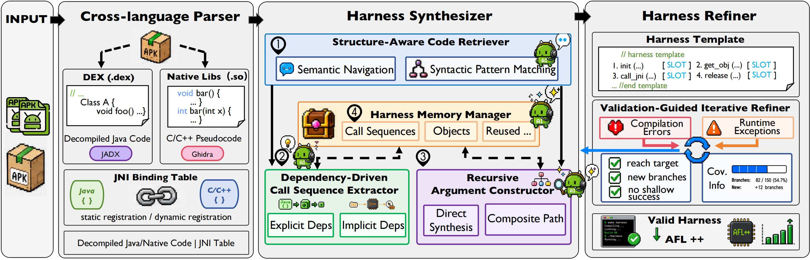

# Janus: Agentic Cross-Language Fuzzing Harness Generation for Android Native Libraries

This repository provides the prototype and artifacts for **Janus**: a prototype framework for agentic
cross-language fuzzing harness generation for Android native libraries.

This work is described in our paper [**Janus: Agentic Cross-Language Fuzzing Harness Generation for Android Native Libraries**](media/Janus_ICSE2027.pdf).

## 0x1 Overview



To address the challenges of generating harnesses for Android native libraries, we introduce **Janus**, a tailored agentic approach for cross-language JNI-aware harness generation. Janus unfolds in three key stages, as shown in Figure Janus takes an APK file as input and employs a divide-and-conquer strategy, separating it into DEX files (`.dex`) and native libraries (`.so`). Specifically, **1️⃣ \*Cross-Language Parser\*** grounds downstream harness synthesis by recovering a unified view of Java–native interactions, dispelling the opacity introduced by JNI indirection. **2️⃣ \*Harness Synthesizer\***, built on a structure-aware retrieval layer, iteratively recovers each JNI method's precursor call sequence, uncovering both explicit and implicit dependencies, and recursively assembling its argument objects in a bottom-up manner; in parallel, the harness memory persists verified intermediate artifacts across methods, alleviating the context pressure of long-horizon reasoning. **3️⃣ \*Feedback-Driven Harness Refiner\*** constrains the generation space with app-specific harness templates and refinement, attributing compilation errors, runtime exceptions, and coverage signals back to the upstream stage responsible for repair, thereby suppressing the hallucinations and omissions that accumulate in long-chain reasoning.

## 0x2 Attachment Download

Since the attachment is too large, we have stored it elsewhere. You can click the link to download it:

- DataSet
  - [POIROT-44](https://drive.google.com/file/d/1c5Z7kbwFhufnyVg1ywXZAb-abQvg5fja/view?usp=sharing)
  - [Vendor-20](https://drive.google.com/file/d/1sN8iay1oLx0T4vdcBrTN1H1rv8iQ_bKt/view?usp=sharing)
- [retool](https://drive.google.com/file/d/1MVz2LVFf-EhFtEry_bJRD7wC2ra-ONwP/view?usp=sharing): Janus requires reverse engineering tools, language servers, and AST-Grep.

## 0x3 Directory

- `src/`: Janus implementation and analysis/fuzzing support code.
- `demo/`: demonstration materials and examples.
- `cve-report/`: reproduced  rq3 cve reports.
- `media/`: paper, overview figure, and README images.

## 0x4 Quick Start

### 4.1 Requirements

The currently validated host environment is **Apple Silicon macOS**. Before you start, prepare:

- **Host tools**: Python 3.10+, Java 21, Android SDK Platform Tools (`adb`), `unzip`, `jadx`, CMake, and an Android NDK.
- **Semantic-retrieval tools**: `clangd`, `jdtls`, `ast-grep`, and Node.js.
- **Agent client**: [OpenCode](https://opencode.ai), the paper's reference client.
- **Android target**: a rooted ARM64 Android emulator or physical device. The supplied harness build scripts target Android API 31 and `arm64-v8a`.
- **Device-side extraction tools**: Termux `clang++` at `/data/data/com.termux/files/usr/bin/clang++`, plus a writable `/data/local/tmp`.
- **Memory**: 64 GB of RAM or more is recommended for decompilation and analysis.

### 4.2 Prepare the Implementation

1. Download `retool` from [Attachment Download](#0x2-attachment-download) and extract it as `src/retool`.
2. From the repository root, enter the implementation directory and prepare the input/output directories:

   ```bash
   cd src
   mkdir -p apks target_APK
   cp ../demo/qb.blogfuzz.apk apks/
   ```

   The repository contains the following main components:

   ```text
   Janus/
   ├── src/            # Janus implementation
   ├── demo/           # Demo APK and generated harness examples
   ├── cve-report/     # Six vulnerability analysis reports
   ├── media/          # Overview figure and demo video
   ├── LICENSE         # GPL-3.0
   └── README.md
   ```

Run the following commands from `src/` unless noted otherwise.

### 4.3 Configure and Check the Environment

Set the Android NDK and select the target device:

```bash
export ANDROID_NDK_HOME=/path/to/android-ndk       # ANDROID_NDK_ROOT is also supported
export OMEN_DEVICE_ID=<adb-serial>
```

Optional settings:

```bash
export OMEN_AFL_DIR="$PWD/assets/afl-binaries"     # default AFL/Frida device-binary directory
export OMEN_FUZZ_TIMEOUT=240                       # AFL run duration in seconds
```

Check device discovery and parser prerequisites:

```bash
adb devices
python3 .agents/skills/omen-pipeline/scripts/preflight.py \
  --stage parser --device "$OMEN_DEVICE_ID"
```

Before the full workflow, also verify device root access, Termux `clang++`, `jadx`, the NDK, and AFL/Frida compatibility. OpenCode reads `opencode.jsonc` from `src/` to configure the Java, native, and Smali language servers.

### 4.4 Run Janus

Start OpenCode in `src/`, then run the current pipeline command with a single APK:

```text
/omen-pipeline /absolute/path/to/Janus/src/apks/qb.blogfuzz.apk
```

To process every APK under `apks/` serially instead, run:

```text
/omen-pipeline
```

The workflow recovers JNI bindings and cross-language sources, synthesizes call sequences and argument objects, validates the generated harnesses, and runs AFL++ Frida Mode fuzzing.

### 4.5 Inspect Results

Generated analysis, harnesses, reviews, runtime state, and fuzzing results are stored under `target_APK/<package>/`. To inspect aggregate progress for a package, run:

```bash
python3 .agents/skills/omen-pipeline/scripts/omen_state.py \
  status --package <package>
```

## 0x5 Explore the Implementation

The [`src/`](src/) directory contains  the engineering implementation of Janus.
To explore the implementation in more detail, continue with the
[Omen README](src/README.md).

It covers:

- the three-stage architecture and two core synthesis algorithms;
- the source-tree layout and canonical agent skills;
- environment configuration and pipeline commands;
- generated analysis, harness, Memory, and fuzzing artifacts.

For the component boundaries, algorithm invariants, and cross-stage contracts, read
[`src/AGENTS.md`](src/AGENTS.md) alongside the implementation README.

## 0x6 Demo Video

We have provided a demo video that demonstrates how the system works, you can open DEMO.mp4 in the media directory.
